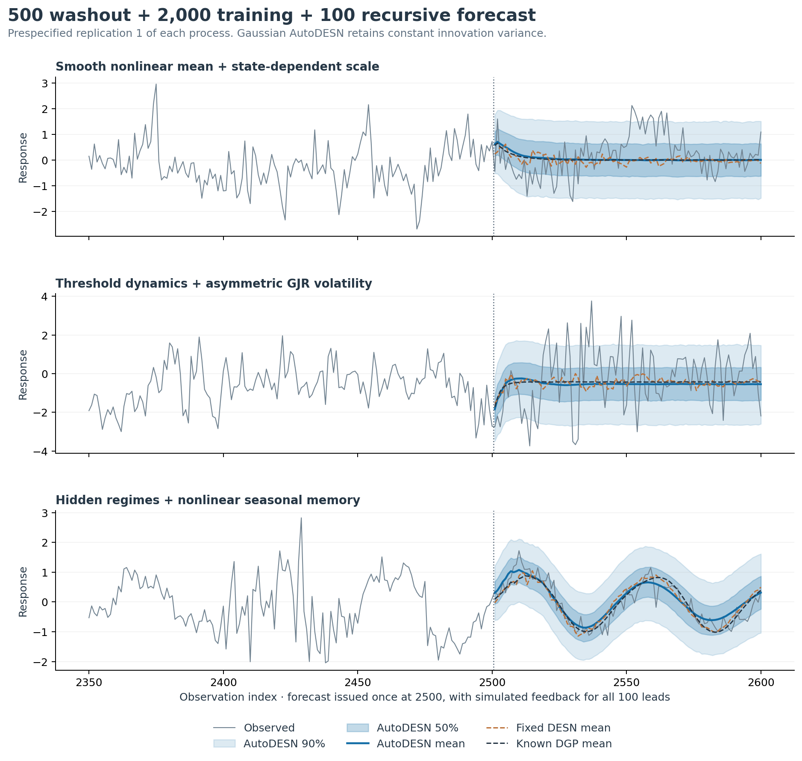
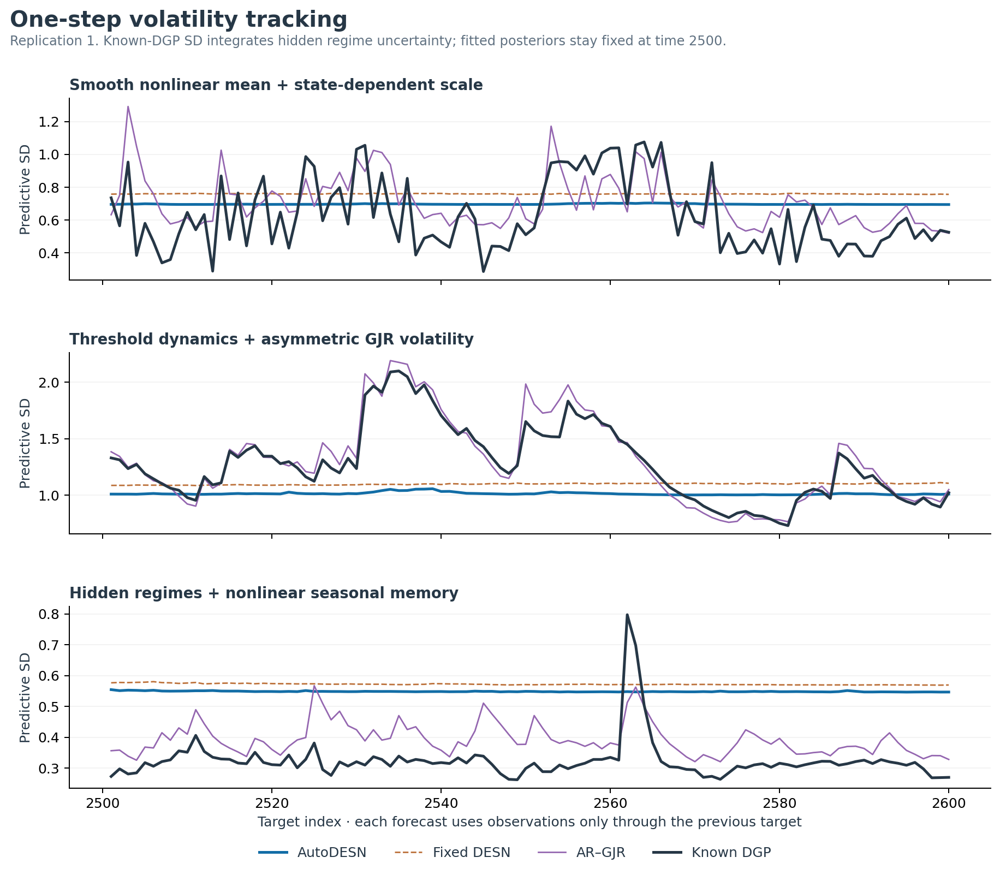
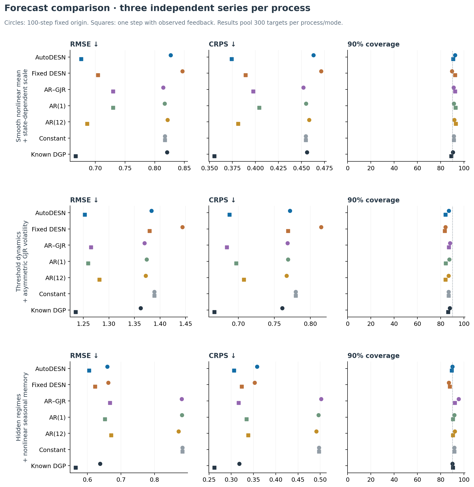
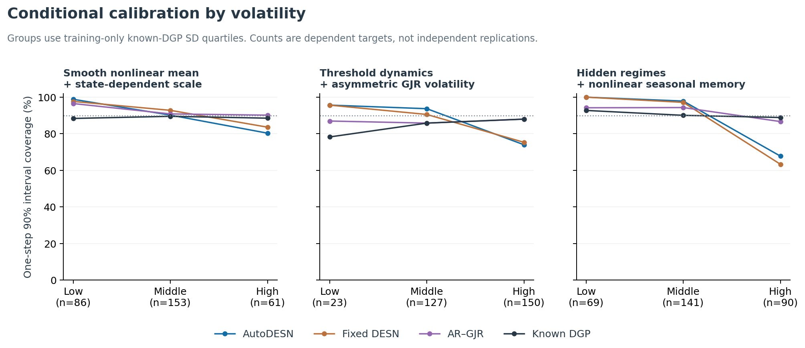

# Earlier fixed-origin and one-step heteroscedastic diagnostics

**The primary evaluation is now [rolling-origin 30-step forecasting](rolling/RESULTS.md).** This page preserves the earlier single 100-step forecast and one-step diagnostics.

All nine cases use 500 initial washout/scaling observations, exactly 2,000 training likelihood contributions (501:2500), and 100 test observations (2501:2600). Three independent series are simulated for each of three custom nonlinear processes. The earlier 500/500/100 experiment is preserved.

**The AutoDESN likelihood remains Gaussian with constant innovation variance and an independent Gaussian ridge prior.** This study tests that implementation under heteroscedastic misspecification; it does not implement a variance reservoir or change the readout prior. The 72-model bank and all simulation parameters are frozen before scoring. See [README](README.md) for equations and full reproduction instructions.

## 100-step recursive forecast

Each forecast is issued once at observation 2500. Every trajectory feeds back its own simulated observations; it receives no held-out outcomes. Means and intervals are marginal over joint posterior draws and stochastic paths.

| Process | Model | RMSE | CRPS | NLL | 90% coverage | 90% width | 50% coverage |
|---|---|---:|---:|---:|---:|---:|---:|
| Smooth scale | AutoDESN | 0.827 | 0.463 | 1.240 | 92.3% | 2.941 | 58.3% |
| Smooth scale | Fixed DESN | 0.847 | 0.471 | 1.250 | 89.7% | 2.792 | 55.7% |
| Smooth scale | AR(1) | 0.817 | 0.455 | 1.221 | 91.3% | 2.883 | 59.3% |
| Smooth scale | AR(12) | 0.822 | 0.458 | 1.225 | 91.7% | 2.888 | 58.0% |
| Smooth scale | AR–GJR | 0.814 | 0.452 | 1.210 | 91.0% | 2.873 | 54.7% |
| Smooth scale | Constant | 0.817 | 0.455 | 1.221 | 91.3% | 2.885 | 59.7% |
| Smooth scale | Known DGP | 0.821 | 0.456 | 1.216 | 90.3% | 2.783 | 50.0% |
| Threshold + GJR | AutoDESN | 1.383 | 0.772 | 1.743 | 87.0% | 3.967 | 42.0% |
| Threshold + GJR | Fixed DESN | 1.444 | 0.815 | 1.814 | 84.0% | 3.838 | 38.0% |
| Threshold + GJR | AR(1) | 1.374 | 0.769 | 1.739 | 87.3% | 3.910 | 41.7% |
| Threshold + GJR | AR(12) | 1.372 | 0.767 | 1.735 | 86.7% | 3.917 | 41.7% |
| Threshold + GJR | AR–GJR | 1.370 | 0.768 | 1.741 | 88.0% | 3.943 | 37.3% |
| Threshold + GJR | Constant | 1.389 | 0.780 | 1.754 | 86.7% | 3.911 | 41.7% |
| Threshold + GJR | Known DGP | 1.362 | 0.761 | 1.729 | 87.7% | 4.023 | 43.0% |
| Switching seasonal | AutoDESN | 0.659 | 0.358 | 1.065 | 90.0% | 2.314 | 67.3% |
| Switching seasonal | Fixed DESN | 0.662 | 0.352 | 1.068 | 87.0% | 2.012 | 63.0% |
| Switching seasonal | AR(1) | 0.882 | 0.496 | 1.309 | 91.7% | 2.859 | 46.0% |
| Switching seasonal | AR(12) | 0.872 | 0.491 | 1.298 | 92.0% | 2.847 | 45.3% |
| Switching seasonal | AR–GJR | 0.881 | 0.502 | 1.358 | 95.3% | 3.462 | 44.7% |
| Switching seasonal | Constant | 0.883 | 0.497 | 1.300 | 91.7% | 2.875 | 46.3% |
| Switching seasonal | Known DGP | 0.638 | 0.318 | 0.745 | 90.0% | 2.031 | 51.7% |

RMSE pools squared errors over 300 targets per process. CRPS and negative log predictive density (NLL) are lower-is-better distribution scores. Coverage needs to be read alongside interval width. The known-DGP reference has true parameters and known clock effects; hidden regimes are observation-filtered. AR–GJR is a training-only plug-in fit that omits parameter uncertainty.

## One-step observed-feedback evaluation

Each target is predicted before observing it. Its observation then updates reservoir lags and volatility filters for later targets. Coefficients and model probabilities remain fixed at time 2500. These scores reuse the same test outcomes and are a separate task, not additional independent replications.

| Process | Model | RMSE | CRPS | NLL | 90% coverage | 90% width | 50% coverage |
|---|---|---:|---:|---:|---:|---:|---:|
| Smooth scale | AutoDESN | 0.676 | 0.374 | 1.027 | 90.7% | 2.306 | 56.7% |
| Smooth scale | Fixed DESN | 0.704 | 0.389 | 1.072 | 92.3% | 2.487 | 59.0% |
| Smooth scale | AR(1) | 0.730 | 0.404 | 1.104 | 92.7% | 2.455 | 53.0% |
| Smooth scale | AR(12) | 0.686 | 0.381 | 1.044 | 93.0% | 2.374 | 54.3% |
| Smooth scale | AR–GJR | 0.730 | 0.398 | 1.046 | 92.3% | 2.382 | 51.0% |
| Smooth scale | Constant | 0.817 | 0.455 | 1.221 | 91.3% | 2.885 | 59.7% |
| Smooth scale | Known DGP | 0.666 | 0.355 | 0.913 | 89.0% | 2.067 | 52.0% |
| Threshold + GJR | AutoDESN | 1.253 | 0.688 | 1.667 | 84.0% | 3.288 | 44.3% |
| Threshold + GJR | Fixed DESN | 1.380 | 0.769 | 1.778 | 83.3% | 3.562 | 43.3% |
| Threshold + GJR | AR(1) | 1.259 | 0.697 | 1.674 | 84.3% | 3.338 | 42.7% |
| Threshold + GJR | AR(12) | 1.282 | 0.708 | 1.699 | 84.0% | 3.320 | 42.0% |
| Threshold + GJR | AR–GJR | 1.265 | 0.684 | 1.574 | 87.0% | 3.654 | 42.3% |
| Threshold + GJR | Constant | 1.389 | 0.780 | 1.754 | 86.7% | 3.911 | 41.7% |
| Threshold + GJR | Known DGP | 1.235 | 0.666 | 1.549 | 86.3% | 3.608 | 47.3% |
| Switching seasonal | AutoDESN | 0.605 | 0.306 | 0.961 | 89.3% | 1.778 | 67.3% |
| Switching seasonal | Fixed DESN | 0.623 | 0.323 | 0.992 | 87.7% | 1.853 | 65.7% |
| Switching seasonal | AR(1) | 0.652 | 0.334 | 1.033 | 90.3% | 1.966 | 66.0% |
| Switching seasonal | AR(12) | 0.670 | 0.338 | 1.086 | 90.3% | 1.886 | 64.3% |
| Switching seasonal | AR–GJR | 0.667 | 0.317 | 0.774 | 92.0% | 1.864 | 54.3% |
| Switching seasonal | Constant | 0.883 | 0.497 | 1.300 | 91.7% | 2.875 | 46.3% |
| Switching seasonal | Known DGP | 0.565 | 0.262 | 0.473 | 90.3% | 1.521 | 55.7% |

RMSE pools squared errors over 300 targets per process. CRPS and negative log predictive density (NLL) are lower-is-better distribution scores. Coverage needs to be read alongside interval width. The known-DGP reference has true parameters and known clock effects; hidden regimes are observation-filtered. AR–GJR is a training-only plug-in fit that omits parameter uncertainty.

## Conditional calibration and replication variability

One-step volatility groups use training-only quartiles of the known-DGP predictive SD. For the switching process this integrates uncertainty in the hidden state. The bins are diagnostic evaluation labels, not information supplied to the fitted forecasts.

| Process | Volatility | Targets | AutoDESN 90% coverage | AR–GJR 90% coverage | Known-DGP 90% coverage |
|---|---|---:|---:|---:|---:|
| Smooth scale | low | 86 | 98.8% | 96.5% | 88.4% |
| Smooth scale | middle | 153 | 90.2% | 90.8% | 89.5% |
| Smooth scale | high | 61 | 80.3% | 90.2% | 88.5% |
| Threshold + GJR | low | 23 | 95.7% | 87.0% | 78.3% |
| Threshold + GJR | middle | 127 | 93.7% | 85.8% | 85.8% |
| Threshold + GJR | high | 150 | 74.0% | 88.0% | 88.0% |
| Switching seasonal | low | 69 | 100.0% | 94.2% | 92.8% |
| Switching seasonal | middle | 141 | 97.9% | 94.3% | 90.1% |
| Switching seasonal | high | 90 | 67.8% | 86.7% | 88.9% |

Three series per process support descriptive comparisons only. The targets are serially dependent, and some volatility groups are small. Monte Carlo paths and forecast horizons are not replication units. Per-series scores are in `artifacts/by_replication.csv`.

| Process | AutoDESN fixed-origin RMSE across series | Fixed DESN RMSE across series |
|---|---|---|
| Smooth scale | 0.844, 0.795, 0.841 | 0.863, 0.804, 0.871 |
| Threshold + GJR | 1.596, 1.479, 1.003 | 1.622, 1.583, 1.057 |
| Switching seasonal | 0.304, 1.019, 0.415 | 0.343, 1.030, 0.370 |

## Sampler and specification audit

All final sampler screens pass: **True**. Across the final AutoDESN and fixed-DESN chains, maximum rank/folded split Rhat is **1.006317**, minimum spectral ESS is **610.3**, and maximum cross-chain model probability range is **0.03160**. Each fit uses three distinct initializations. All attempts, including any failed earlier screens, are retained in `diagnostics.csv`.

4 of 18 fits required the prespecified diagnostic-only retry. No retry depends on forecast performance. All nine fitted GJR references have a converged selected optimization start; their starts and constrained parameters are exported.

| Retried fit | Attempts | Final max Rhat | Final min ESS | Final model-chain range |
|---|---:|---:|---:|---:|
| Smooth scale, series 2, AutoDESN | 2 | 1.001541 | 993.3 | 1.45 pp |
| Switching seasonal, series 2, AutoDESN | 3 | 1.001581 | 3396.5 | 2.69 pp |
| Switching seasonal, series 3, AutoDESN | 3 | 1.000766 | 1219.4 | 1.45 pp |
| Threshold + GJR, series 1, AutoDESN | 2 | 1.003399 | 655.6 | 2.03 pp |

| Process | Series | Highest-probability specification | Posterior mass |
|---|---:|---|---:|
| Smooth scale | 1 | depth 1, width 50, lag 5, fast, seed 11 | 96.0% |
| Smooth scale | 2 | depth 1, width 50, lag 5, fast, seed 29 | 32.9% |
| Smooth scale | 3 | depth 2, width 20, lag 5, fast, seed 29 | 43.6% |
| Threshold + GJR | 1 | depth 3, width 50, lag 5, fast, seed 11 | 65.5% |
| Threshold + GJR | 2 | depth 1, width 20, lag 5, fast, seed 29 | 73.5% |
| Threshold + GJR | 3 | depth 1, width 50, lag 5, fast, seed 11 | 71.5% |
| Switching seasonal | 1 | depth 3, width 50, lag 30, fast, seed 29 | 86.1% |
| Switching seasonal | 2 | depth 2, width 50, lag 5, slow, seed 29 | 61.6% |
| Switching seasonal | 3 | depth 3, width 50, lag 30, fast, seed 11 | 71.7% |

Specification mass measures relative fit under the frozen finite bank, priors and constant-variance likelihood. It is not a probability that the data-generating process literally is a DESN, nor a guarantee of good conditional coverage.

## Forecast Monte Carlo and verification

The primary AutoDESN forecasts use 192 joint model/coefficient/variance draws, each repeated across 64 innovation trajectories: 12,288 paths. A joint draw is fixed over all leads. Pooled type-8 quantiles estimate predictive intervals; conditional Gaussian locations are averaged to reduce current-innovation Monte Carlo noise. Log scores average Gaussian component densities along paths.

For the first prespecified smooth-scale series, K=32 versus K=128 changes the forecast mean by RMS 0.00632 and the 90% endpoints by RMS 0.02020. This is paired inner-path sensitivity with the same outer draws, not total posterior Monte Carlo uncertainty.
For the first prespecified smooth-scale series, K=64 versus K=128 changes the forecast mean by RMS 0.00326 and the 90% endpoints by RMS 0.01164. This is paired inner-path sensitivity with the same outer draws, not total posterior Monte Carlo uncertainty.

- Seven new contract-test groups pass: prefix invariance, heterogeneous positive scales, independent GJR recursions, hidden-state filtering and mixture moments, causal issue timing, exact 2,000-row training, serial/parallel seed replay, and Gaussian mixture scores.
- 393 focused existing installed-package expectations pass across AutoDESN, 100-step forecasts, Normal readout and recursive mean-state behavior, without failures, warnings or skips.
- `audit_results.py` independently verifies exported splits, source hashes, actuals, coverage, widths, errors, model mass, chain screens, path indices and aggregated metrics. See `artifacts/audit_report.json`.
- Full repository release checks were not rerun for this simulation-only extension. The previously documented inherited packaging and historical-study failures remain unresolved; this is not a claim that global CI is green.

## Reading the result

A nonlinear mean model can improve location forecasts while retaining a nearly constant one-step innovation scale. Under quiet conditions its intervals can be too wide, and after large shocks they can be too narrow. Recursive state uncertainty can widen a long-horizon distribution, but that does not substitute for learning conditional innovation variance. A GJR comparator can react to residual shocks yet still miss nonlinear mean and hidden-regime structure. The observation-filtered known-DGP reference separates those model limitations from irreducible future noise.

Nearly flat long-horizon means can be appropriate when nonlinear dynamics lose information about the initial state. A forecast mean averages future shocks and should not be expected to trace one realized noisy test path. The seasonal oracle also knows the clock effects, which response-only DESNs must infer from lagged responses.

Structure weights are learned from the assumed conditional training likelihood. They do not directly optimize 100-step forecast error, and misspecification can affect both structure weights and recursive performance. Better sampling cannot supply a conditional variance process that is absent from the likelihood.

The next modeling step, if conditional coverage matters, is an explicitly positive variance process with its own causal recursion and posterior uncertainty. That changes the likelihood and inference target and should be validated separately. These results do not establish that SMC is needed: the finite homoscedastic bank still supports the existing blocked Gibbs updates.

## Figures

All six figures also have PDF versions. Complete series/splits and posterior depth probabilities are in the remaining figures. The representative plots always use replication 1; examples were not selected by their forecasting scores.
