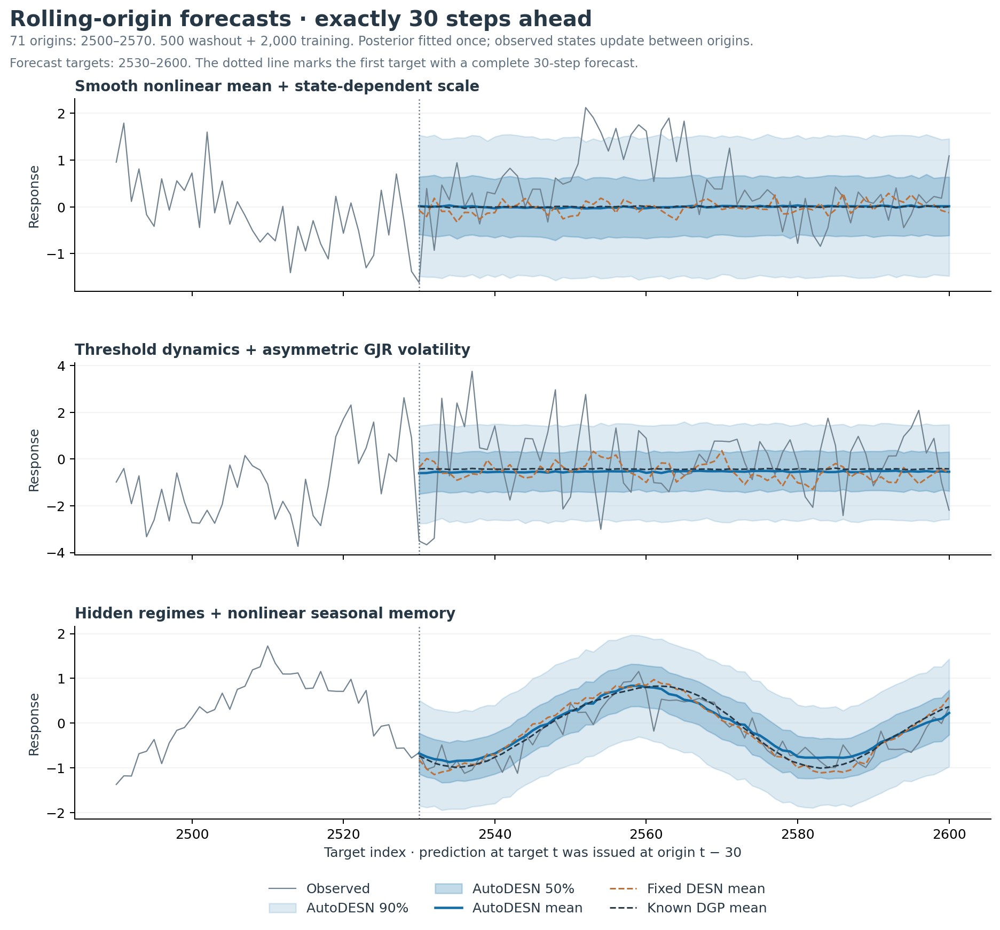
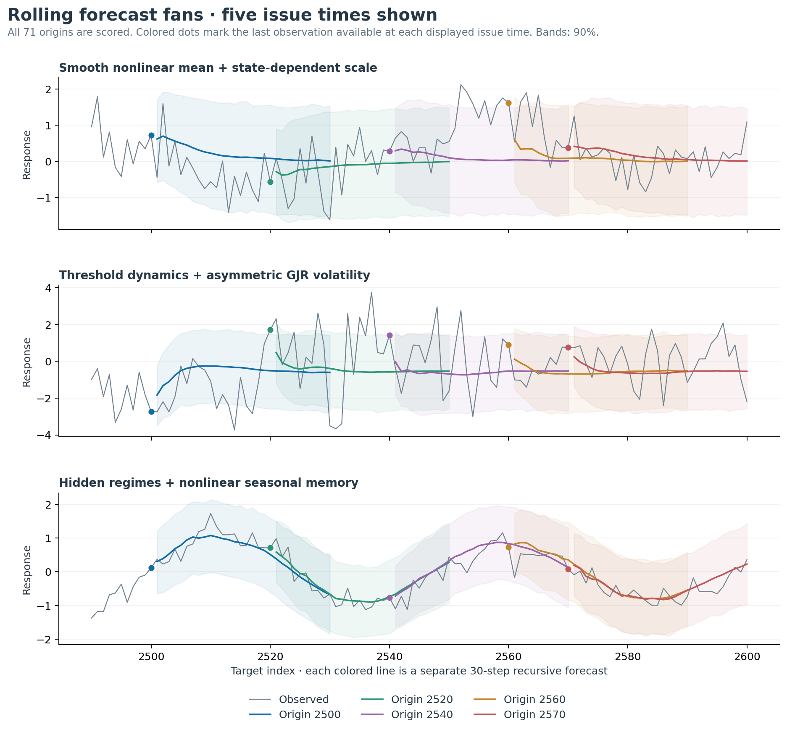
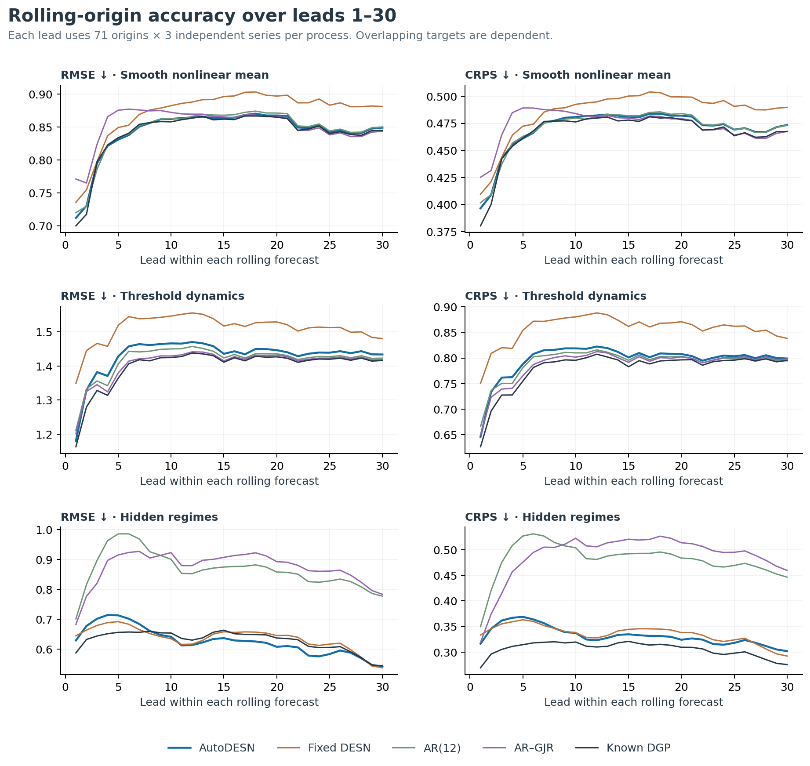
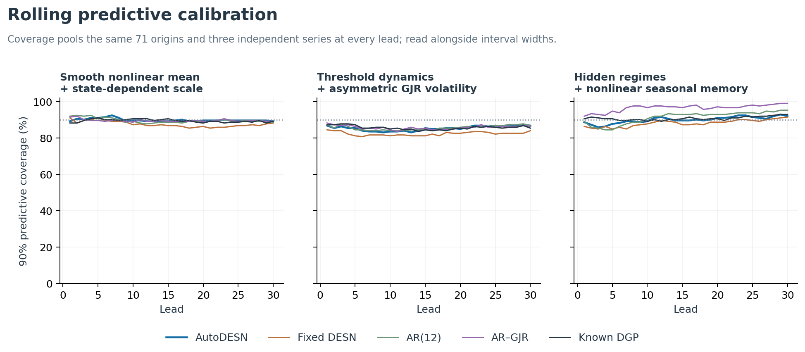

# Primary results: rolling-origin 30-step forecasts

**This is rolling-origin H=30 with observed feedback between origins and simulated feedback within each forecast.** The posterior is fitted once at time 2500. Parameters, architecture probabilities, reservoir weights, bridges and preprocessing remain fixed. This follows the repository’s corrected Q-DESN protocol; there is no refitting at each origin.

The initial split is 500 washout observations (1:500) and exactly 2,000 training likelihood contributions (501:2500). The same 100 held-out values (2501:2600) support 71 complete origins, 2500:2570, with all leads 1:30. There are three independent series for each of three nonlinear heteroscedastic DGPs.

| Origin | Last observed response | Forecast targets | Feedback inside the forecast |
|---:|---:|---|---|
| 2500 | y[2500] | 2501:2530 | Simulated values only |
| 2501 | y[2501] | 2502:2531 | Simulated values only |
| 2570 | y[2570] | 2571:2600 | Simulated values only |

For example, y[2501] updates the state before issuing the forecast at origin 2501. It never enters the forecast issued at origin 2500. A plot of consecutive 30-step-ahead predictions is therefore still a 30-step-ahead evaluation: the prediction at target t was issued at t−30.

The earlier [single 100-step forecast and one-step diagnostics](../RESULTS.md) are preserved separately. The rolling protocol was specified after that earlier run, at the user’s request. DGPs, priors, the 72-model bank and the initial fit window were not retuned. The Gaussian AutoDESN continues to assume constant innovation variance and an independent Gaussian ridge prior.

## Forecast comparison

The table gives RMSE at leads 1, 10 and 30, followed by distribution scores over all 30 leads. Every lead uses the same 71 origins and three series. “All leads” averages origin/lead pairs with equal weights; forecasts issued at different origins are never pooled into one predictive interval.

| Process | Model | RMSE h=1 | RMSE h=10 | RMSE h=30 | CRPS, all leads | 90% coverage | 90% width |
|---|---|---:|---:|---:|---:|---:|---:|
| Smooth scale | AutoDESN | 0.712 | 0.862 | 0.849 | 0.470 | 89.9% | 2.890 |
| Smooth scale | Fixed DESN | 0.736 | 0.882 | 0.881 | 0.485 | 87.6% | 2.731 |
| Smooth scale | AR(1) | 0.771 | 0.875 | 0.848 | 0.476 | 89.5% | 2.871 |
| Smooth scale | AR(12) | 0.720 | 0.863 | 0.850 | 0.470 | 89.7% | 2.847 |
| Smooth scale | AR–GJR | 0.771 | 0.872 | 0.843 | 0.473 | 89.6% | 2.870 |
| Smooth scale | Constant | 0.859 | 0.875 | 0.848 | 0.481 | 89.3% | 2.886 |
| Smooth scale | Known DGP | 0.700 | 0.858 | 0.845 | 0.466 | 89.5% | 2.766 |
| Threshold + GJR | AutoDESN | 1.180 | 1.466 | 1.434 | 0.796 | 85.4% | 3.934 |
| Threshold + GJR | Fixed DESN | 1.349 | 1.546 | 1.480 | 0.857 | 82.4% | 3.772 |
| Threshold + GJR | AR(1) | 1.199 | 1.431 | 1.423 | 0.788 | 86.0% | 3.889 |
| Threshold + GJR | AR(12) | 1.212 | 1.450 | 1.423 | 0.791 | 85.6% | 3.889 |
| Threshold + GJR | AR–GJR | 1.202 | 1.429 | 1.419 | 0.787 | 85.8% | 4.014 |
| Threshold + GJR | Constant | 1.367 | 1.432 | 1.422 | 0.794 | 85.9% | 3.910 |
| Threshold + GJR | Known DGP | 1.163 | 1.425 | 1.416 | 0.780 | 85.7% | 3.999 |
| Switching seasonal | AutoDESN | 0.628 | 0.641 | 0.540 | 0.332 | 90.1% | 2.120 |
| Switching seasonal | Fixed DESN | 0.644 | 0.634 | 0.537 | 0.335 | 88.2% | 1.957 |
| Switching seasonal | AR(1) | 0.668 | 0.914 | 0.777 | 0.482 | 92.5% | 2.818 |
| Switching seasonal | AR(12) | 0.701 | 0.901 | 0.777 | 0.481 | 91.4% | 2.743 |
| Switching seasonal | AR–GJR | 0.682 | 0.923 | 0.783 | 0.488 | 96.6% | 3.487 |
| Switching seasonal | Constant | 0.920 | 0.916 | 0.777 | 0.496 | 92.7% | 2.875 |
| Switching seasonal | Known DGP | 0.587 | 0.653 | 0.543 | 0.306 | 90.8% | 1.894 |

Lower RMSE, CRPS and negative log score are better. Coverage must be read with interval width. Complete log scores, 50% intervals, MAE, per-origin, per-lead and per-series metrics are exported. The known-DGP reference has true parameters and clock effects; its hidden regimes are observation-filtered. AR–GJR is a fitted plug-in reference with no parameter uncertainty. The AR references use their shared Normal scaled-ridge posterior, rather than AutoDESN’s independent ridge prior.

There are 2,130 origin/lead pairs per series, but only 100 distinct held-out observations. Overlapping targets and forecast origins are dependent. The independent replication count is three series per process; these results are descriptive, not a general superiority claim. Absolute scores should be compared between models within the same process.

| Process | AutoDESN h=30 RMSE, series 1 / 2 / 3 | Fixed DESN h=30 RMSE, series 1 / 2 / 3 |
|---|---|---|
| Smooth scale | 0.858 / 0.863 / 0.826 | 0.872 / 0.877 / 0.894 |
| Threshold + GJR | 1.580 / 1.630 / 1.005 | 1.670 / 1.637 / 1.050 |
| Switching seasonal | 0.262 / 0.824 / 0.355 | 0.318 / 0.803 / 0.346 |

At lead 30, AutoDESN improves on the prespecified fixed DESN in the smooth-scale and threshold examples; the two DESNs are close in the switching-seasonal example. Across all leads, AutoDESN has lower CRPS than fixed DESN in all three examples. AR/GJR references remain competitive or better in the short-memory examples, while both DESNs capture seasonal structure that these linear references miss. Small differences, including a fitted model occasionally scoring better than the known-DGP reference, do not establish population superiority.

Threshold-process rolling 90% coverage is 85.4% for AutoDESN and 85.7% for the known-DGP reference. This finite, overlapping test block therefore does not isolate variance misspecification from pooled coverage alone. The earlier one-step volatility-bin analysis provides a separate conditional-calibration diagnostic; uncertainty about its small dependent subgroups still matters.

## What this evaluates

Rolling origins allow the reservoir and volatility filters to use newly observed responses before each new forecast is issued. They do not provide the future responses inside an issued forecast. This separates adaptation to observed shocks from prediction of unknown future shocks. In short-memory processes, a flat long-horizon mean can be appropriate even while each new origin refreshes the short-horizon forecast.

AutoDESN learns relative probabilities over a prespecified finite reservoir bank under its assumed training likelihood. High posterior mass does not guarantee optimal recursive forecast error or correct conditional variance. Better state updates and longer MCMC runs do not add a missing innovation-variance process. The earlier one-step conditional-calibration analysis remains useful for diagnosing that limitation.

## Inference replay, checkpoints and verification

All 18 final fit screens pass. Maximum Rhat is **1.006317**, minimum spectral ESS is **610.3**, and maximum model probability range across chains is **0.03160**. The final diagnostic-selected sampler seeds/durations are exactly replayed from the earlier experiment; failed earlier attempts remain in its original ledger. Model parameters are not relearned after time 2500.

The restored checkpoint path replay has maximum absolute error **0** against all 64 archived original trajectories over their first 30 leads in every case. The model-probability replay maximum difference is **4.3e-16**. These checks verify that changing the forecast protocol did not silently change the initial fitted posterior.

Each origin uses 192 joint posterior draws × 16 innovations = 3,072 DESN paths. The same joint draws are reused across origins, held fixed over all leads. Quantiles pool paths using type 8; means average Gaussian component locations. Compact RDS checkpoints include selected joint draws and terminal states, so later horizon/origin experiments can reuse the fits. They are validation forecast objects, not complete training-design fit objects.

| First-origin Monte Carlo sensitivity | Mean RMS difference from K=32 | 90% endpoint RMS difference from K=32 |
|---|---:|---:|
| K=8, all nine cases | 0.01048 | 0.04141 |
| K=16, all nine cases | 0.00622 | 0.02506 |

Sensitivity uses paired innovation subsets and fixed posterior draws. It is an inner-path diagnostic, not total posterior Monte Carlo uncertainty; small forecast rankings should not be overstated.

- Three rolling contract-test groups pass: causal future replacement, fixed-origin equivalence, observed-state timing, all-layer state recovery including depth 3, joint-draw reuse, serial/parallel origin parity, innovation subset replay, complete origin/lead indices and GJR observed-update timing.
- **569 independent rolling evidence checks** pass over all **134,190** origin/lead score rows, plus all **18** restored checkpoints, **17,280** replayed path values and **648** replayed architecture probabilities.
- The existing seven heteroscedastic contract-test groups and 393 focused installed-package regression expectations remain passing; production R code is unchanged by this rolling adapter.
- All captured inference-source hashes match. Earlier fixed-origin outputs are preserved. Repository-wide release checks were not rerun; inherited packaging/historical-study failures remain documented.
- Elapsed case times include fitting/replay, all comparators, forecasts, scoring and file output. This is not an equal-compute comparison of Gibbs and SMC.

## Figures

Forecast examples always show replication 1; five issue times are prespecified for the fan plot. All 71 origins and all nine independent series enter the score tables. PDF versions accompany every figure.
